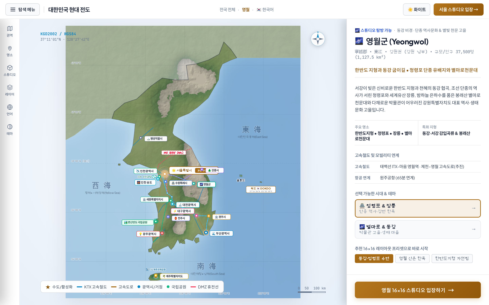
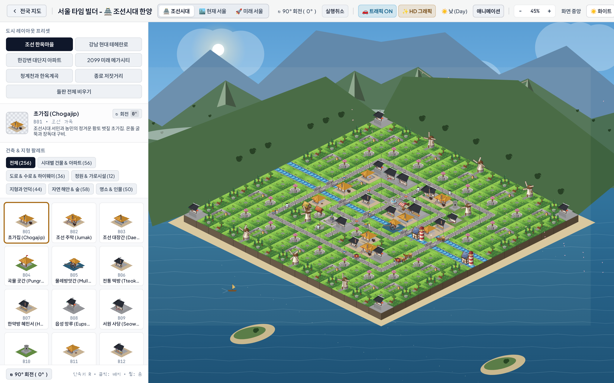
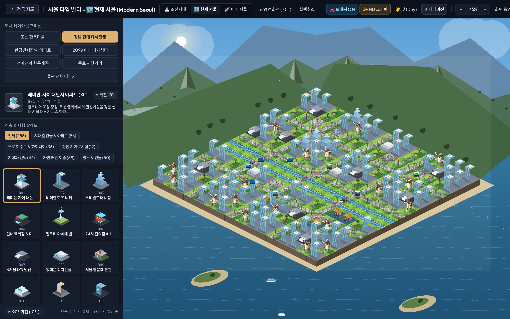

# 🇰🇷 대한민국 시공간 아틀라스 & 아이소메트릭 시티 빌더
### Korea Spacetime Atlas & 16×16 Isometric City Builder

> **▶ [Play the live demo](https://edumgt.github.io/A-web-based-Hanok-simulator-game/)** — Explore Korea and build a Joseon-era Hanok village directly in your browser.
>
> Enjoyed it? Please give the project a ⭐ **Star** — it helps others discover the demo.

**[🇰🇷 한국어 안내](#-한국어-안내) · [🇺🇸 English Guide](#-english-guide) · [📸 주요 화면 캡처 (Screenshots)](#-주요-화면-캡처--key-screenshots)**

---

## 📸 주요 화면 캡처 / Key Screenshots

### 1. 실사 위성·음영기복 대한민국 현대 전도 · *Photorealistic Korea Satellite & GIS Atlas*

> **KR**: WGS84 실측 해안선·도서 지형과 산맥 음영기복(태백·소백·한라산·개마고원), 동·서·남해 수심, KTX/SRT 고속철도망, 주요 고속도로, 변산반도 국립공원, 인천 송도, 울릉도·독도 등 15개 주요 거점을 수록한 인터랙티브 전국 지도 화면입니다.  
> **EN**: Interactive full-peninsula WGS84 satellite & shaded-relief atlas featuring hypsometric mountain relief, bathymetric seas, KTX/SRT high-speed rail, expressways, DMZ, Ulleungdo & Dokdo, and 15 interactive cities & national parks.

---

### 2. 조선시대 16×16 한옥마을 스튜디오 · *Joseon Era 16×16 Hanok Village Studio*

> **KR**: 기와집, 초가집, 종로 저잣거리, 주막, 정자 등 256종의 타일을 90° 회전하며 배치할 수 있는 조선시대 아이소메트릭 스튜디오입니다. 건물 배치 시 타일 위로 가볍게 튀어 오르는 바운스 애니메이션과 주변 산맥·강·바다 배경 파노라마가 어우러집니다.  
> **EN**: 16×16 dimetric 2:1 Joseon Era studio with traditional giwa & thatched hanoks, 256 rotatable tiles, tactile spring-bounce placement animation, living villagers, and scenic mountain-to-sea surroundings.

---

### 3. 현대 서울 강남 테헤란로 & 미래 도시 스튜디오 (다크 모드) · *Modern Seoul Skyline & Multi-Era Studio (Dark Mode)*

> **KR**: 강남 테헤란로 마천루와 고층 오피스 단지부터 한강변 아파트, 2099 네오 메가시티까지 시대를 넘나들며 도시를 설계할 수 있습니다. 다크 테마 UI와 함께 도로망을 달리는 실시간 차량 트래픽 시뮬레이션이 동작합니다.  
> **EN**: Multi-era skyline builder showcasing Modern Seoul's Gangnam Teheran-ro high-rise district in Dark UI mode, with 256 modular tiles, live road vehicle simulation, and instant switching to 2099 Future Megacity.

---

# 🇰🇷 한국어 안내

## 소개
**대한민국 시공간 아틀라스 & 아이소메트릭 시티 빌더**는 실사 위성·음영기복 기반의 **대한민국 현대 전도(GIS 인트로 맵)**와 **조선시대 · 현재 서울 · 2099 미래 메가시티** 3대 시대를 아우르는 **16×16 2:1 아이소메트릭 도시 건축 스튜디오**를 결합한 인터랙티브 웹 애플리케이션입니다.

전국 지도에서 주요 도시와 국립공원의 지리·인프라 정보를 다국어(5개국어)로 탐색한 뒤, 원하는 지역의 건축 스튜디오로 즉시 진입해 살아 움직이는 디오라마 도시를 직접 설계하고 고해상도 PNG 이미지로 저장할 수 있습니다.

## 핵심 기능

### 1. 실사 위성·지형 기반 대한민국 현대 전도 (WGS84 GIS)
- **실사 위성 & 음영기복 렌더링**: 실제 한반도 WGS84 해안선과 주요 섬(제주도, 강화도, 영종도, 거제도, 남해도, 진도, 완도, 울릉도, 독도 등), 산맥 고도별 식생·음영기복, 서해 갯벌·대륙붕과 동해 심해 수심을 정밀하게 합성한 실사형 베이스맵을 제공합니다.
- **15개 주요 도시 및 국립공원 수록**: 서울특별시, 부산광역시, 인천광역시, **인천 송도국제도시**, 대구광역시, 대전광역시, 광주광역시, 수원특례시, 세종특별자치시, 경주시, 전주시, **변산반도 국립공원**, 강릉시, 제주특별자치도, 평양직할시를 클릭해 상세 도시에(Dossier)와 프리셋을 확인할 수 있습니다.
- **국가 기간망 레이어 토글**: 실사 위성·지형 지도, KTX/SRT 고속철도망, 주요 고속도로망, 국립공원 및 자연보전구역 레이어를 개별 ON/OFF 할 수 있습니다.

### 2. 모던 LNB 오프캔버스 네비게이션 & 다국어 · 테마 지원
- **슬림 퀵 레일 + 오프캔버스 LNB**: 좌측 아이콘 레일(권역·명소·스튜디오·레이어·언어·테마)과 슬라이드 오프캔버스 드로어로 지도 가시 영역을 극대화했습니다.
- **실시간 검색 & 스튜디오 바로가기**: 도시·국립공원 실시간 필터 검색과 각 지역별 스튜디오 직행 런처 링크를 LNB에서 바로 제공합니다.
- **5개국어 완벽 지원**: **한국어 (`KO`), 영어 (`EN`), 중국어 (`ZH`), 일본어 (`JA`), 스페인어 (`ES`)** 5개 언어로 지도 지명, 범례, 해양/영토 표기, 상세 설명을 즉시 전환할 수 있습니다.
- **화이트 / 다크 모드 (Light & Dark Theme)**: 전국 지도와 건축 스튜디오 양쪽에서 주간 위성 아틀라스 감성의 화이트 모드와 몰입감 높은 다크 모드를 자유롭게 오갈 수 있습니다.

### 3. 3대 시대 16×16 아이소메트릭 시티 빌더
- **시대별 건축 세계관 전환**:
  - **🏯 조선시대**: 초가집, 기와집, 대감집, 주막, 대장간, 서원, 정자, 돌담길, 청계천 수로
  - **🏙️ 현재 서울**: 강남 오피스 마천루, 한강변 대단지 아파트, 롯데월드타워, N서울타워, 아스팔트 대로
  - **🚀 2099 미래 서울**: 사이버 네오 메가타워, 홀로그램 아크로폴리스, 바이오스피어 돔, 하이퍼루프·스카이웨이
- **건물 배치 스프링 바운스 애니메이션**: 건물과 구조물을 타일에 배치할 때 소켓 위로 가볍게 튀어 올랐다가 착지하는 탄성 바운스 효과와 황금빛 지면 링 피드백이 적용되어 경쾌한 손맛을 제공합니다.
- **90° 회전 & 실시간 고스트 프리뷰**: 단축키 `R` 또는 회전 버튼으로 건축물을 `0° / 90° / 180° / 270°` 회전하며 배치 전 반투명 고스트 프리뷰로 방향을 미리 확인할 수 있습니다.
- **살아 숨 쉬는 교통·시민 시뮬레이션 & 낮/밤 조명**: 도로와 수로 타일을 자동 인식해 조선 보행자·수레, 현대 자동차·버스, 미래 플라잉카(UAM)가 주행하며, 낮(벚꽃잎·햇살)과 밤(창가 불빛·반딧불이·야경) 조명을 실시간 전환할 수 있습니다.
- **고해상도 스냅샷 내보내기**: 완성한 16×16 도시 전체를 `2,176 × 1,216` 픽셀 무손실 PNG로 다운로드하거나 클립보드에 복사할 수 있습니다.

## 시작하기 (Quick Start)

### 사전 요구사항
- **Node.js** 18 이상 및 **npm**

### 설치 및 실행
```bash
# 1. 의존성 패키지 설치
npm install

# 2. 개발 서버 실행 (http://localhost:3000)
npm run dev

# 3. 프로덕션 빌드 및 타입 체크
npm run build
npm run lint
```

## 조작 방법 및 단축키

| 동작 | 마우스 / UI 조작 | 단축키 |
| :--- | :--- | :--- |
| **타일 / 건물 배치** | 캔버스 좌클릭 또는 드래그 페인팅 | — |
| **건물 90° 방향 회전** | 상단/사이드바 `↻ 90° 회전` 버튼 클릭 | `R` |
| **화면 이동 (패닝)** | 빈 영역 드래그 / 우클릭 드래그 / 휠클릭 드래그 | `Space` + 드래그 |
| **확대 / 축소 (줌)** | 마우스 휠 스크롤 또는 상단 `−` / `+` 버튼 | — |
| **실행 취소 (최대 40단계)** | 상단 `실행취소` 버튼 | `Ctrl + Z` / `Cmd + Z` |
| **LNB 메뉴 닫기 / 모달 닫기** | 배경 클릭 또는 `×` 버튼 | `Esc` |

## 프로젝트 구조

```text
├── docs/screenshots/             # README 수록 실제 앱 주요 화면 캡처 (3종)
├── src/
│   ├── App.tsx                   # 메인 애플리케이션 셸 & 스튜디오 마크업
│   ├── main.tsx                  # React 엔트리 포인트
│   ├── koreaSatelliteTerrain.js  # WGS84 실측 해안선·산맥 음영기복·위성 지형 프로시저럴 렌더러
│   ├── koreaModernMapData.js     # 15개 도시·국립공원 데이터 및 지역별 스튜디오 프리셋 매핑
│   ├── koreaMapI18n.js           # 5개국어(한·영·중·일·스페인어) 번역 사전
│   ├── koreaMapMarkup.js         # 전국 지도 SVG, LNB 오프캔버스, 상단바 마크업
│   ├── koreaMapEngine.js         # 전국 지도 인터랙션, 검색, 레이어·언어·테마 상태 엔진
│   ├── studioEngine.js           # 16×16 아이소메트릭 렌더러, 건물 바운스 애니메이션, 브러시/프리셋 엔진
│   ├── joseonHouseTiles.js       # 조선시대 전통 가옥 픽셀/프로시저럴 타일 생성기
│   ├── modernSeoulTiles.js       # 현대 서울 & 2099 미래 메가시티 타일 생성기
│   ├── scenicEnvironment.js      # 월드 외곽 산맥·강·해안·하늘 배경 파노라마 렌더러
│   ├── trafficEngine.js          # 시대별 시민·차량·UAM 실시간 경로 주행 시뮬레이션
│   └── styles.css                # 화이트/다크 테마 디자인 토큰 및 반응형 레이아웃 스타일
├── index.html
├── package.json
└── vite.config.ts
```

---

# 🇺🇸 English Guide

## Overview
**Korea Spacetime Atlas & Isometric City Builder** combines a **photorealistic WGS84 satellite & shaded-relief GIS map of the Korean Peninsula** with an interactive **16×16 dimetric (2:1) isometric city-building studio** spanning three distinct eras: **Joseon Dynasty**, **Modern Seoul**, and **2099 Future Megacity**.

Explore 15 major Korean cities and national parks in **5 languages**, toggle national rail and highway infrastructure layers, switch seamlessly between **Light and Dark modes**, and launch directly into the isometric studio to craft living dioramas complete with tactile placement animations, autonomous traffic, and Day/Night atmosphere.

## Key Features

### 1. Photorealistic WGS84 Korea Satellite & Shaded-Relief Map
- **Procedural Satellite & Hypsometric Relief**: Synthesizes authentic WGS84 Korean Peninsula mainland & island coastlines (Jeju, Ganghwa, Yeongjong/ICN, Geoje, Ulleungdo, Dokdo) with directional hillshading across major mountain ranges (Taebaek, Sobaek, Hallasan, Kaema Plateau) and bathymetric depth gradients across the West, South, and East Seas.
- **15 Interactive Cities & National Parks**: Inspect detailed geographic dossiers and launch regional presets for Seoul, Busan, Incheon, **Incheon Songdo International City**, Daegu, Daejeon, Gwangju, Suwon, Sejong, Gyeongju, Jeonju, **Byeonsanbando National Park**, Gangneung, Jeju, and Pyongyang.
- **Infrastructure & Conservation Layers**: Independently toggle Satellite Terrain, KTX/SRT High-Speed Rail, Expressways, and National Park Reserve overlays.

### 2. Modern Offcanvas LNB UX, 5 Languages & Dual Themes
- **Compact Quick Rail + Offcanvas Drawer**: Keeps the cartographic viewport unobstructed while offering one-click access to regional filters, live place search, direct studio launchers, and map layers.
- **5-Language Localization**: Instant full-UI and map-label switching across **Korean (`KO`), English (`EN`), Chinese (`ZH`), Japanese (`JA`), and Spanish (`ES`)**.
- **Light & Dark Themes**: Crisp daylight cartographic mode and high-contrast dark observatory mode synchronized across both the Korea Atlas and the Isometric Studio.

### 3. Multi-Era 16×16 Isometric City Builder
- **Three Playable Eras & 7 Curated Presets**: Build traditional **Joseon Hanok Villages**, **Modern Gangnam Teheran-ro Skylines & Han River Apartment Complexes**, or **2099 Cyberpunk Neo-Megacities** using 256 categorized tiles.
- **Tactile Building Placement Bounce**: Newly placed buildings and structures lightly pop upward above their isometric tile socket with a golden ground ripple and soft shadow response before settling cleanly into place.
- **90° Tile Rotation (`R`) & Ghost Preview**: Rotate buildings and roads across four orientations (`0°`, `90°`, `180°`, `270°`) with live translucent cursor previews.
- **Living Traffic, Scenic Panorama & Day/Night Lighting**: Watch era-authentic villagers, cars, and flying UAM vehicles navigate road networks against surrounding mountains, rivers, and coastlines—and export full `2,176 × 1,216` PNG snapshots anytime.

## Getting Started

```bash
# Install dependencies
npm install

# Start the development server at http://localhost:3000
npm run dev

# Build for production & run TypeScript checks
npm run build
npm run lint
```

## Controls & Shortcuts

| Action | Mouse / UI Control | Shortcut |
| :--- | :--- | :--- |
| **Place Tile / Building** | Left-click or drag across grid cells | — |
| **Rotate Active Building (90°)** | Click `↻ 90°` in Top Bar or Sidebar | `R` |
| **Pan Camera** | Drag empty canvas, right-drag, or middle-drag | `Space` + Drag |
| **Zoom Camera** | Mouse wheel scroll or `−` / `+` buttons | — |
| **Undo (up to 40 steps)** | Click `실행취소` (Undo) button | `Ctrl + Z` / `Cmd + Z` |
| **Close Drawer / Modal** | Click backdrop scrim or `×` button | `Esc` |

## Tech Stack
- **Frontend**: React 19, TypeScript, Vanilla HTML5 2D Canvas & SVG GIS Engine
- **Build Tooling**: Vite 6, Tailwind CSS 4 / Custom Design Tokens
- **Rendering**: Depth-sorted 2:1 dimetric painter's algorithm, procedural satellite hillshading, and 60fps spring-physics placement animations
